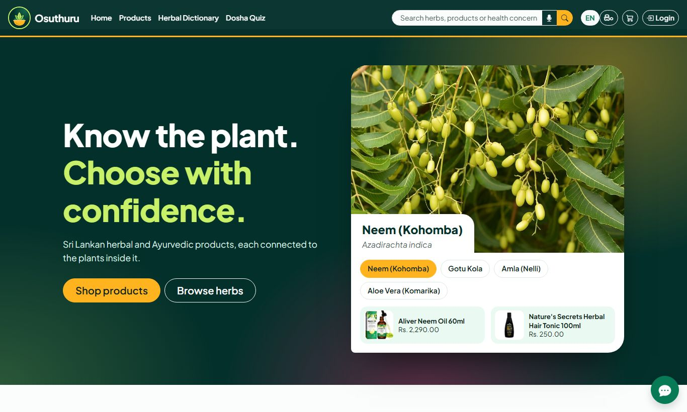
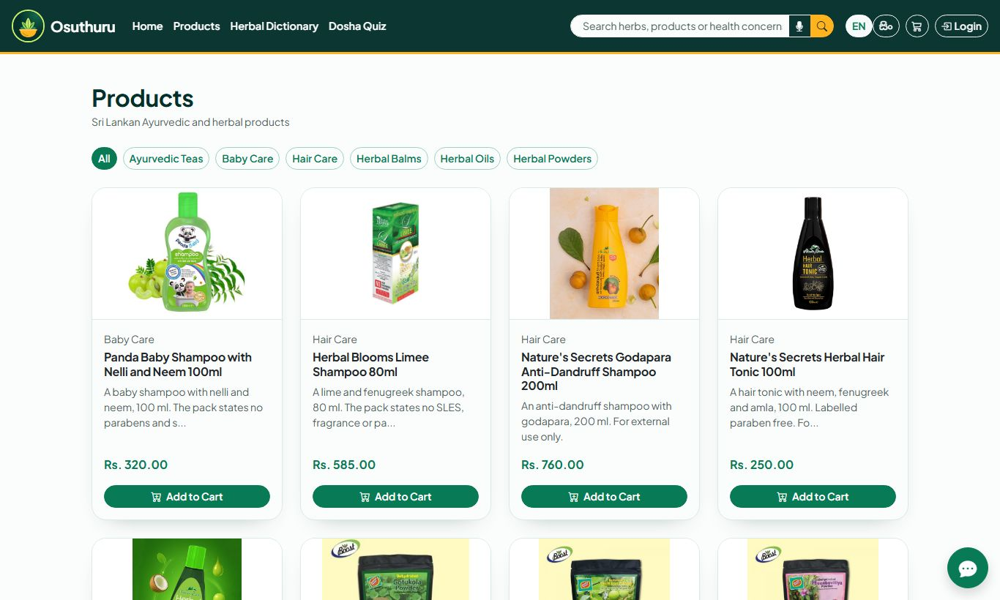
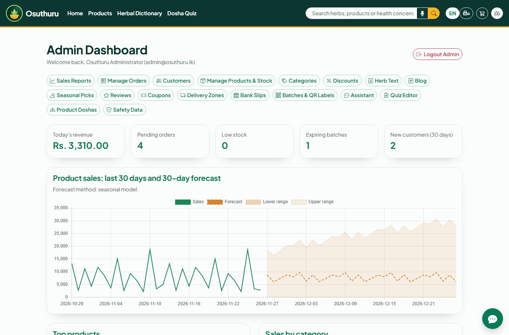
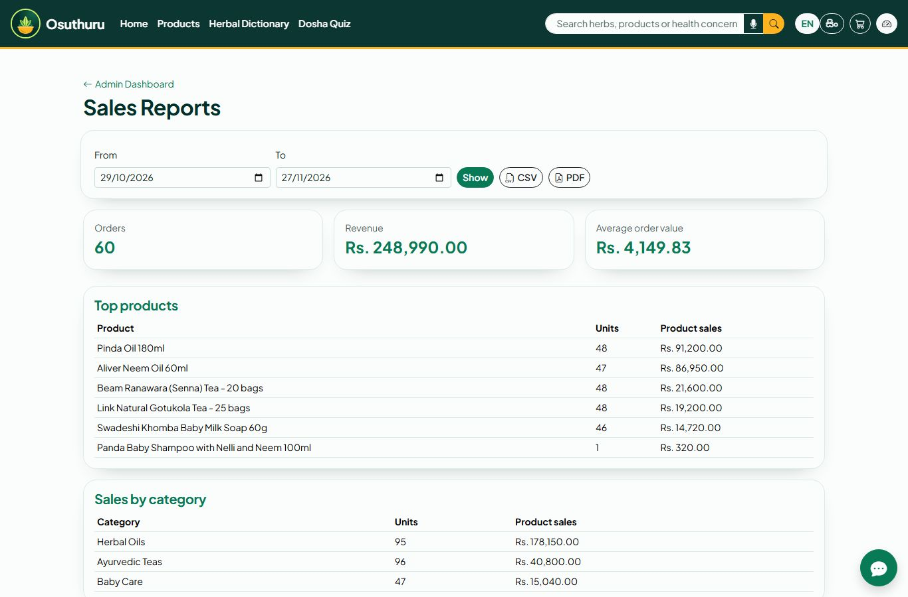
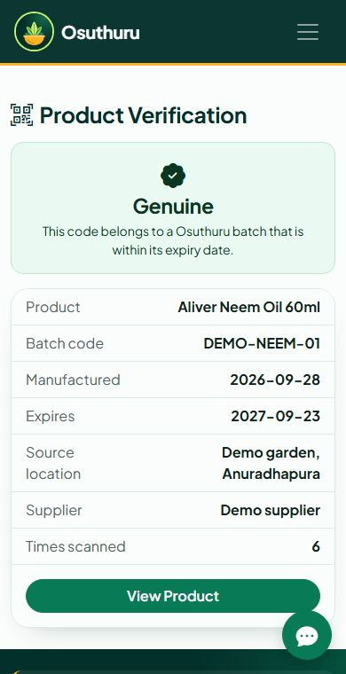
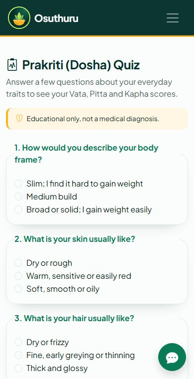
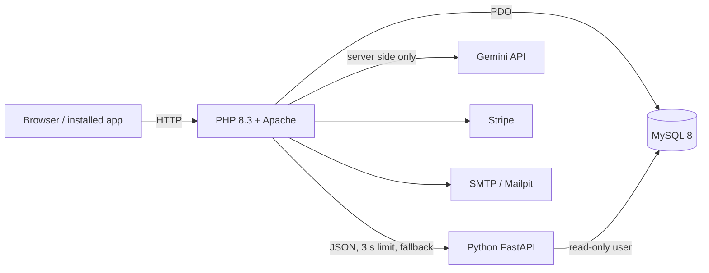

# Osuthuru

> Herbal and Ayurvedic e-commerce platform for Sri Lanka, in English and Sinhala.
> *Know your body → Find the right herb → Verify it is genuine → Buy safely*



## Features
| Area | What it does |
|---|---|
| Shop | Catalogue, cart, cash on delivery, bank transfer and card payment, delivery fees by district, coupons, order timeline and emails, invoices, wishlist and back-in-stock alerts |
| Herb knowledge | Bilingual herb dictionary, health topics, search with autocomplete, "did you mean" and voice search |
| Dosha quiz and safety checker | Prakriti quiz with product suggestions; warnings before payment. Safety answers are never stored |
| Traceability | Product batches, QR labels and a public Genuine / Expired / Recalled page |
| Assistant | Chat that answers only from the shop's own data, with a fallback when no AI key is set |
| Recommendations and forecasts | Python service with a PHP fallback; 30-day sales forecast and days to stock-out |
| Admin | Dashboard, CSV/PDF reports, orders, customers, catalogue, reviews, blog, seasonal picks |
| Installable app | Works as a PWA with an offline herb dictionary |

| | |
|---|---|
|  |  |
|  |   |

Screenshots show demonstration data.

## Architecture

- **Web app**: PHP 8.3 without a framework, PSR-4 classes in `src/`, routes in `public/index.php` and `routes/`, templates in `templates/`
- **Database**: MySQL 8, numbered migrations in `database/migrations/` ([ER diagram](docs/ERD.md))
- **Intelligence**: Python 3.12 FastAPI in `ml/`
- **Front end**: Bootstrap 5.3, vanilla JavaScript, Chart.js

## Quick start
```bash
git clone <repo-url> suwoda-herbhub-v2
cd suwoda-herbhub-v2
cp .env.example .env
docker compose up -d --build
docker compose exec web composer install
docker compose exec web php bin/migrate.php
docker compose exec web php bin/seed.php --demo
docker compose exec web php bin/grant_ml_user.php
docker compose exec web php bin/create_admin.php
```
Open http://localhost:8080. The admin area is at `/admin/login`; `create_admin.php` uses `ADMIN_EMAIL` and `ADMIN_PASSWORD` from `.env` (change the password).

- `seed.php` loads the catalogue. Add `--demo` for demonstration customers, 30 days of orders, batches, quiz, safety samples and reviews. It refuses to load demo data when `APP_ENV=production`.
- Demo customers: `nimali@demo.invalid`, `kasun@demo.invalid`, `fathima@demo.invalid`, password `DemoPass123!`.
- **All health, safety and dosha text in the demo data is placeholder text marked DEMO or SAMPLE. It is not medical information.**

| Service | Address |
|---|---|
| Website | http://localhost:8080 (also reachable from your network) |
| Mail inbox (Mailpit) | http://localhost:8025 |
| ML service | http://localhost:8000/health |
| MySQL | `localhost:3306`, user `app`, database `osuthuru` |

Only the website is reachable from the network; the others listen on `127.0.0.1`.

## Tests
```bash
docker compose exec web composer test     # PHPUnit
docker compose exec ml pytest             # ML service
```
PHPUnit rebuilds separate test databases on every run (using `DB_ROOT_PASS`), so development data is not touched. GitHub Actions ([.github/workflows/ci.yml](.github/workflows/ci.yml)) runs the PHP syntax check, PHPUnit, a fresh install with demo data, and pytest.

## Using a phone
1. In PowerShell run `pwsh bin/set_lan_url.ps1`. It sets `APP_URL` to this PC's network address (add `-Local` to undo).
2. Open that address on a phone on the same network. Print QR labels afterwards, and again if the address changes.
3. If the page does not load, allow inbound port 8080 in the firewall, on trusted networks only.

**Installing the app on a phone** needs a secure address, and a plain network address is not one.

*iPhone or Android, over Wi-Fi:* run `pwsh bin/setup_https.ps1`, then follow the four steps it prints. It serves the site on port 8443 with a certificate the phone must be told to trust. The signing key is deleted straight away. When you have finished, remove the profile from the phone and run `pwsh bin/setup_https.ps1 -Remove`.

*Android with a USB cable:* enable USB debugging on the Android phone, open `chrome://inspect/#devices` in Chrome on the PC, add a port forward `8080` → `localhost:8080`, then open `http://localhost:8080` on the phone and choose **Install app**. Voice search also needs `localhost` or HTTPS.

With `APP_DEBUG=true`, error details are visible to anyone on the network. In Docker, visitors may all appear to come from one address, which affects the assistant limit and duplicate-scan count during development.

## Using the features

### Dosha quiz and safety checker
- The quiz ships as an **unpublished draft**. Have it reviewed, then publish at `/admin/quiz`. Enter descriptions and tips there, and match products (strength 1 to 3) at `/admin/dosha`.
- Safety data is managed at `/admin/safety`. Only **published** entries are shown, and publishing requires a warning and its source.
- Safety answers stay in the visitor's session (and in the browser's `localStorage` if they ask). An `avoid` match must be acknowledged at checkout. Signed-in users can save quiz scores, not answers.

### QR traceability
- Create batches at `/admin/batches` and download label sheets. Each QR opens `/verify?t=...`.
- More than 50 different scanning addresses raise a duplicate warning. Confirmed orders take packs from the batch that expires first.

### Shop assistant
- Set `LLM_PROVIDER=gemini`, `LLM_MODEL=gemini-3.5-flash-lite` and `LLM_API_KEY` in `.env`, then check with `docker compose exec web php bin/test_llm.php`.
- If the main model is busy, slow or withdrawn, `LLM_FALLBACK_MODEL` (default `gemini-3.5-flash`) is tried within the same 15-second limit.
- The model receives only catalogue data and published safety notes. Limits: 500 characters, 20 questions per hour per address, 6 turns, 24-hour cache, 15-second timeout. Chat is deleted after 30 days.
- Review unmatched questions and topic words at `/admin/assistant`.

### Recommendations and forecasts
- The ML service reloads data every 15 minutes. If it is stopped or slow, PHP shows simpler SQL results.
- Its database user reads only the tables and columns it needs (`php bin/grant_ml_user.php`).
- Offline evaluation, on a separate database of **synthetic** orders ([results](ml/reports/recommender_eval.md)):
  ```bash
  docker compose exec web php bin/build_eval_db.php
  docker compose exec ml python -m app.evaluate --database osuthuru_eval
  ```

## Catalogue pictures and prices

Catalogue pictures are in `public/assets/images/catalog/`. Plant and background photographs come from Wikimedia Commons and are credited on `/credits`. Product pictures show the makers' packaging and were carried over from V1: **get the makers' or the photographer's permission before running a real shop.** Admin uploads still go to `public/uploads/` and replace the catalogue picture.

Where each price came from, and how sure we are, is listed in [docs/PRICE_SOURCES.md](docs/PRICE_SOURCES.md). On an existing install run `bin/migrate.php` and then `bin/seed.php` to get the pictures and the new products.

## Renaming an install made before November 2026

The shop was renamed to Osuthuru. A new install needs nothing special. For an older database: back it up, import the dump into a new database called `osuthuru`, set `DB_NAME=osuthuru` and the new `ADMIN_EMAIL` in `.env`, restart, run `bin/grant_ml_user.php`, and change the e-mail address of the existing row in the `admin` table. Logo and app icons are built from `docs/branding/` with `php bin/make_icons.php`.

## Security notes

Folder listing is off. Bank slips cannot be opened by their address: an administrator views them through the application. Keep it that way if you move to another web server (Nginx ignores `.htaccess`).

## Behaviour to know about
- **Time**: the application and database work in Asia/Colombo.
- **Accounts**: email verification is required; five failed logins lock an email and address for 15 minutes; blocking a customer ends their access at once.
- **Orders**: stock returns once when an order is cancelled. Cancelled is final, delivered orders cannot be cancelled, and a paid cancelled order must be refunded manually. A product with orders cannot be deleted.
- **Reviews**: a customer reviews a product once, after delivery.
- **Languages**: shop, admin and emails are in English and Sinhala. PDF files (invoice, labels, reports) are English because the PDF library cannot shape Sinhala; the Sinhala invoice is a printable page.
- **PHP packages** live in the `vendor_data` Docker volume; run `composer install` after changing `composer.lock`.

## Before real use
- A qualified practitioner must review health content: `php bin/export_review_pack.php` writes `docs/review/practitioner_review.csv`.
- A native speaker must review Sinhala text: `docs/review/sinhala_content.csv` and, from `php bin/export_translations.php`, `docs/translation_review.csv`.
- Set real secrets, `APP_ENV=production` and `APP_DEBUG=false`, serve over HTTPS, and do not load demo data.

## Project phases
- [x] Phase 0: Foundation
- [x] Phase 1: Security and core fixes
- [x] Phase 2: Commerce for Sri Lanka
- [x] Phase 3: Herbal knowledge and bilingual search
- [x] Phase 4: Dosha quiz and safety checker
- [x] Phase 5: QR traceability and assistant
- [x] Phase 6: Python intelligence service
- [x] Phase 7: Admin analytics, PWA and quality

Not built (stretch items in the roadmap): PayHere, leaf identification, review summaries, loyalty points and the recommendation click log.

The full plan is in [docs/ROADMAP.md](docs/ROADMAP.md). For the presentation, follow the [viva demo guide](docs/DEMO_GUIDE.md) (Sinhala).

Customers get one email when an order is placed (card orders: when payment succeeds) and one for each later status change; in development they appear in Mailpit.
